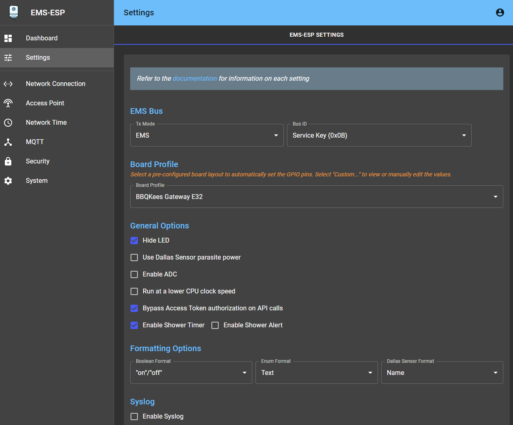
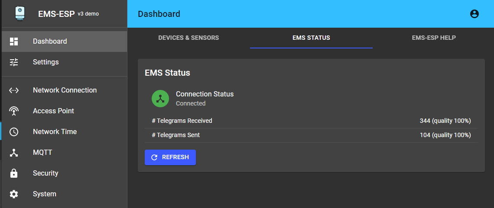
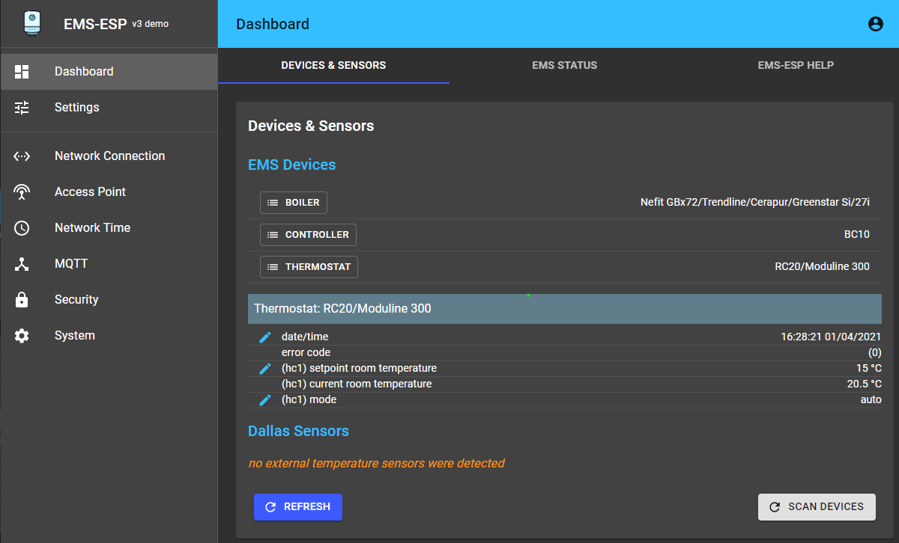
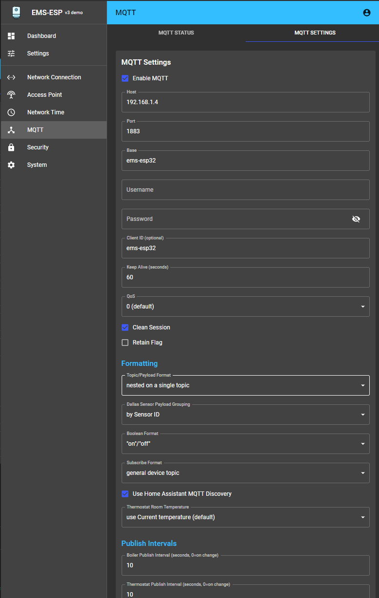
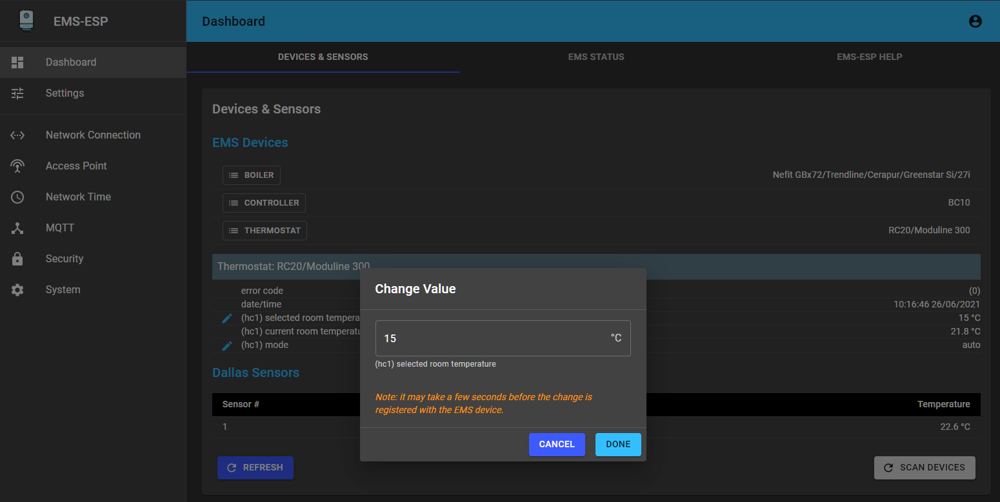
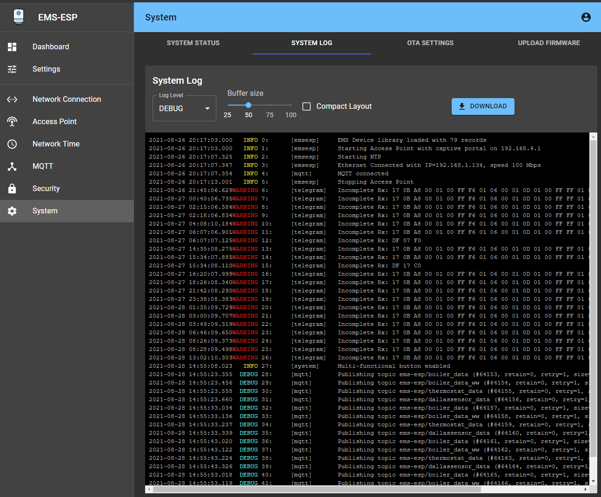
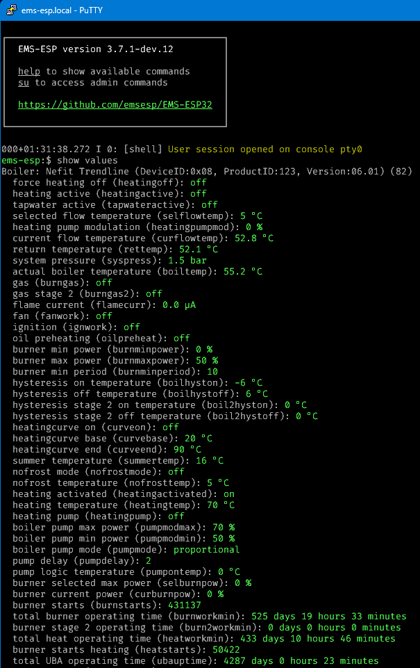
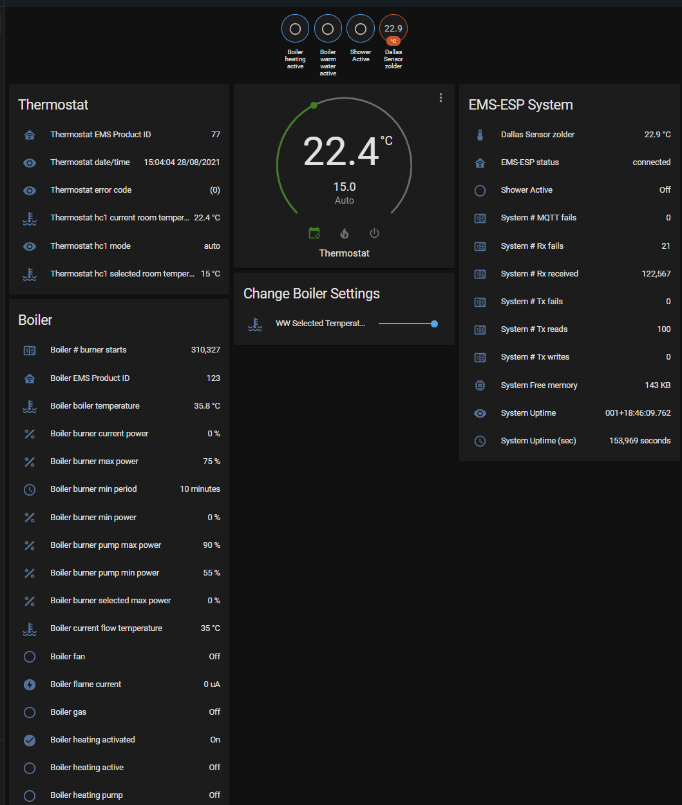

  

    
  

<h1 align="center">EMS-ESP</h1>

  
  
  
  
  

**EMS-ESP** is an open-source firmware for the Espressif ESP32 microcontroller to communicate with **EMS** (Energy Management System) compatible equipment from manufacturers such as Bosch, Buderus, Nefit, Junkers, Worcester, Sieger, elm.leblanc and iVT.

It requires a small circuit to interface with the EMS bus which can be purchased from <https://bbqkees-electronics.nl>. These gateways are tested thoroughly and certified to work with EMS-ESP.

## 📦&nbsp; **Key Features**

- Compatible with EMS, EMS+, EMS2, EMS Plus, Logamatic EMS, Junkers 2-wire, Heatronic 3 and 4
- Supporting over 120 different EMS compatible devices such as thermostats, boilers, heat pumps, mixing units, solar modules, connect modules, ventilation units, switches and more
- Easy to add external Temperature and Analog sensors that are attached to GPIO pins on the ESP32 board
- A multi-user, multi-language web interface to change settings and monitor incoming data
- A simple to use console, accessible via Serial/USB or Telnet for advanced operations and detailed monitoring
- Native integration with Home Assistant, Domoticz, openHAB and Modbus
- Easy setup and install with automatic updates
- Simulation of remote thermostats
- Localized in 11 languages, and customizable to rename any device or sensor
- Extendable by adding own custom EMS entities
- Expandable via adding user-built external modules
- A powerful Scheduler to automate tasks and trigger events based data changes
- A Notification service to alert you of important events

## 🚀&nbsp; **Installing**

Head over to the [Installation Guide](https://emsesp.org/Installing) section of the documentation for instructions on how to install EMS-ESP.

## 📋&nbsp; **Documentation**

Visit [emsesp.org](https://emsesp.org) for more details on how to setup and configure EMS-ESP. You'll also find more a collection of example configuarations, Frequently Asked Questions and Troubleshooting tips.

## 💬&nbsp; **Getting Support**

To chat with the community reach out on our [Discord Server](https://discord.gg/GP9DPSgeJq).

If you find an issue or have a request, see the [Getting Support](https://emsesp.org/Support/) section of the documentation. Note if you are using a non-BBQKees EMS gateway, you may need to contact the manufacturer for support.

## 🎥&nbsp; **Live Demo**

To see a live demo go to [demo.emsesp.org](https://demo.emsesp.org). Pick a language and use any username and password to log in. Note whast you're seeing is static example data so not all features are operational.

## 💖&nbsp; **Contributors**

EMS-ESP is a project originally created by [proddy](https://github.com/proddy) and maintained by the ems-esp community.

If you like **EMS-ESP**, please give it a ✨ on GitHub, or even better fork it and contribute. You can also offer a small donation. This is an open-source project maintained by volunteers, and your support is greatly appreciated.

## 📦&nbsp; **Building**

See the [Building the firmware](https://emsesp.org/Building) guide in the documentation for instructions on how to build EMS-ESP from this source code.

## 📢&nbsp; **Libraries used**

- [esp8266-react](https://github.com/rjwats/esp8266-react) originally by @rjwats for the core framework that provides the Web UI, which has been heavily modified
- [uuid-\*](https://github.com/nomis/mcu-uuid-console) from @nomis. The console, syslog, telnet and logging are based off these awesome open source libraries
- [ArduinoJson](https://github.com/bblanchon/ArduinoJson) for all the JSON processing
- [espMqttClient](https://github.com/bertmelis/espMqttClient) for the MQTT client
- [ESPAsyncWebServer](https://github.com/ESP32Async/ESPAsyncWebServer) and [AsyncTCP](https://github.com/ESP32Async/AsyncTCP) for the Web server

## 📜&nbsp; **License**

This program is licensed under GPL-3.0-or-later

## **Screenshots**

### Web Interface

|                                    |                                  |
| ---------------------------------- | -------------------------------- |
|  |  |
|   |    |
|      |     |

### Telnet Console

### Home Assistant

